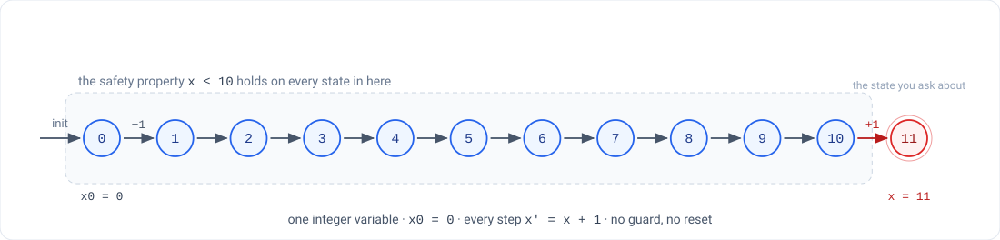

# HW1 — Logic, SAT/SMT, and bounded reachability

**CS 3892 / CS 5892 · Formal Methods: Safe and Trustworthy AI · Fall 2026**

| | |
|---|---|
| **Out** | Thursday, September 10 |
| **Due** | **Thursday, September 24, 11:59 p.m. US Central** |
| **Weight** | 4% of the course grade (100 points) |
| **Tool** | Z3 — Python API and SMT-LIB 2 |
| **Zero-install path** | Google Colab, or GitHub Codespaces |
| **Submit** | Brightspace → Assignments → *HW1 — Logic; SAT-SMT; bounded reachability (Z3)* |

Nothing to install. Every part of this runs in a browser tab.

> **Clarified Sat Sep 19** — Part 1 now says explicitly that you write your own five statements,
> and Part 3 now gives the counter's initial value and transition rule, which were missing. The
> due date and the point split are unchanged. If you already started, nothing you have done is
> wasted; check Part 3's numbers against what you assumed.

**Start here:** [github.com/ttj/cs3892-examples](https://github.com/ttj/cs3892-examples) has a
starter notebook for this homework with each part stubbed out, plus every worked example from
sessions 5 onward in both SMT-LIB and Python.

---

## What this is for

By the end you should be able to take an English requirement, write it down as a formula, decide it
with a solver, and — the part that matters — **know whether the answer you got is the answer to the
question you meant to ask.** A wrong encoding that returns `unsat` looks exactly like a correct one.

---

## Part 1 — Logic warm-up  *(20 points)*

Translate five English statements into propositional and, where they need it, first-order logic.
For each one, **decide satisfiability and validity by hand first**, then confirm with Z3.

**The five statements are yours to write** — there is no fixed list. Take them from a domain you
care about: a security policy, a course rule, a requirement on an AI system. Make the set cover
the ground:

- at least **one valid** formula,
- at least **one satisfiable but not valid**,
- at least **one unsatisfiable**,
- and at least **two** that need **quantifiers** rather than plain propositional logic.

Write the English sentence, the formula, and your by-hand verdict *before* you run anything. The
five requirements worked on slide 24 of the session 6 deck are there as models of the translation
step — their formulas are already printed on the slide, so do not submit those five as your own.

Doing it both ways is the point: you are calibrating your own judgement against a decision
procedure. Where you and Z3 disagreed, say so and say who was right.

Recall the identity everything here rests on:

> φ is **valid** exactly when ¬φ is **unsatisfiable**.

A solver has no "is it valid?" button, so every validity question you ask becomes a
satisfiability question about the negation.

## Part 2 — Encoding  *(30 points)*

Encode a combinatorial puzzle as an SMT query: pigeonhole, n-queens, sudoku, or KenKen. Starters
are provided for each.

Then **report solve times as the size grows, and say where the wall is.** A table and one
sentence of interpretation. "It got slow around n = 12" is not an answer; "it goes from
milliseconds to minutes between n = 11 and n = 12, which is where the search stops fitting in the
clause database" is closer.

## Part 3 — Bounded reachability  *(30 points)*

Write the counter below as a transition system and ask Z3 whether `x` can reach 11 within `N`
steps.

**The machine.** One integer variable `x`.

| | |
|---|---|
| **Initial state** | `x = 0` |
| **Transition** | `x' = x + 1`, every step, unconditionally |
| **Question** | can `x` equal `11` within `N` steps? |

There is no guard, no reset, and no upper bound inside the machine. The cap of 10 is the
*property* you are testing, not something the transition relation enforces — which is exactly why
`x = 11` is the value worth asking about.

In the starter (`p3_reachability_starter.py`) that is `X0 = 0`, `STEPS = [1]`, `TARGET = 11`;
`STEPS` is the list of amounts one step may add, so here it has a single element. Unroll `N`
steps, constrain each transition, assert the target appears somewhere, and ask.

**Find the smallest `N` for which the answer changes, and explain precisely why that `N`.**
"Z3 said so" is not the explanation. The threshold is a fact about the machine's arithmetic, and
your job is to give the argument that makes it obvious without running anything.

This is the running example for the whole semester — you will verify this same property four more
times with four more tools, so it is worth understanding completely now. **One thing to carry
forward:** the versions in HW2–HW5 *do* have a guard (`x` increments only while `x < 10`, and
resets at the cap), and that guard is what makes them safe. This one deliberately has none, so
that bounded model checking has something to find.

## Part 4 — AI component  *(20 points)*

Ask an LLM to produce the SMT-LIB encoding for Part 3. Report what it got right, what it got
wrong, and — critically — **how you knew.**

An encoding that is `unsat` for the wrong reason looks exactly like a correct one until you check
it, so say what check you ran. Reading it over and finding it plausible does not count. Asserting
the negation of a property you know should hold, and watching it come back `sat` with a model you
can read, does.

---

## What to submit

One archive or repository link containing:

1. Your `.py` and/or `.smt2` files, runnable as-is.
2. A short report — Markdown or PDF, roughly two pages — with the answers, the timing table, and
   your Part 4 write-up.
3. The AI-use disclosure (see below).

The mechanical part is checked automatically: do your files run, and do they produce the verdicts
you claim? The interesting part — why the counterexample looks like that — is read by a human.

## Late policy

Four late days for the semester, in whole-day units, no more than two on any one homework, no
questions asked. Beyond that, 20% per day.

## Collaboration and AI use

Discussion is encouraged; submitted work must be your own. **AI assistants are allowed and
expected** — this is a course about the reliability of AI-produced artifacts. Two conditions:

1. **Disclose.** Say what you used and for what.
2. **Verify.** You are responsible for everything you submit, and "the model said so" does not
   transfer that responsibility. It carries less weight in this course than almost anywhere else,
   because every tool you will use is a decision procedure that can tell you whether the model was
   right — so use one.
