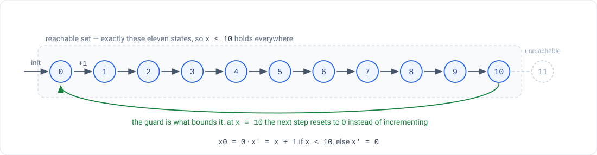

# The running example — a bounded counter

**CS 3892 / CS 5892 · Formal Methods: Safe and Trustworthy AI · Fall 2026**

Every tool in this course verifies a variant of **one** property on **one** machine. This page is
the single definition of both. If a homework, a quiz, or a slide ever disagrees with this page,
this page is right and the other one is a bug — tell me.

The point of reusing one machine is not that it is interesting. It is that by HW5 you will have
proved essentially one fact five ways, and the differences between those five proofs — what each
one assumes, what each one would miss — are the actual content of the course.

---

## The machine

One integer variable `x`.

| | |
|---|---|
| **State** | `x : Int` |
| **Initial state** | `x = 0` |
| **Transition** | `x' = x + 1` if `x < 10`, else `x' = 0` |

`x` is declared over **all** the integers, not over `{0, …, 10}`. That matters: if the type
already bounded `x`, the property below would be true by declaration and there would be nothing
to prove. The bound is a *consequence* of the transition relation, and proving it is the job.

## The property

> **P:**  `x ≤ 10`  —  equivalently, `x = 11` is never reached.

The reachable set is exactly `{0, 1, …, 10}`, eleven states. **P is inductive**: it holds in the
initial state, and every transition preserves it — from `x < 10` you reach `x + 1 ≤ 10`, and from
`x ≥ 10` you reach `0`. That is a stronger statement than "P is an invariant," and the difference
is what Session 9 and Quiz 3 are about.

## The buggy variant

HW1 uses a **different machine**, deliberately — one where the property fails:

| | |
|---|---|
| **State** | `x : Int` |
| **Initial state** | `x = 0` |
| **Transition** | `x' = x + 1`, every step, unconditionally |

Read that transition in full rather than as "the canonical machine minus the guard." Dropping the
guard also drops the reset — there is no `else` branch at all — so this is not the canonical
machine with one clause deleted. `x` simply counts up forever, `P` fails, and the first violation
is at step 11.

**This is the one place in the course where the property is false**, and that is the point: HW1
asks a bounded model checker to *find* a violation, which is the easy direction. Everything after
HW1 works on the machine at the top of this page, where the property holds and the interesting
question is how you know.

---

## What each tool says, and what it means

| Homework | Tool | Style | Verdict you should get | What that verdict does **not** tell you |
|---|---|---|---|---|
| HW1 | Z3 | bounded, buggy variant | `sat` at N = 11, with a trace | — this one is a genuine counterexample |
| HW1 | Z3 | bounded, canonical machine | `unsat` for every N you try | **nothing about steps past N.** Bounded means bounded |
| HW2 | NuSMV / nuXmv | unbounded, BDD reachability | `x <= 10` is `true` | nothing about a machine with a different cap — it re-proves from scratch |
| HW3 | CBMC | bounded, on real C source | `VERIFICATION SUCCESSFUL` | the same bound caveat as HW1, now on C semantics |
| HW4 | Lean 4 | inductive proof, all N at once | builds, `sorry`-free | nothing about the C code actually shipping |
| HW5 | α,β-CROWN / Marabou | neural-network reachability | — | a different notion of "reachable" entirely |

Five verdicts, five different meanings of the word "verified." **HW1's `unsat` and HW2's `true`
look equally reassuring and are not the same claim** — working out precisely how they differ,
which ones would miss a bug past the bound, and which ones force you to supply an inductive
invariant, is the intellectual point of the homework sequence.

## Where this came from

The [`ttj/fmaiv`](https://github.com/ttj/fmaiv) repository threads a richer version of this same
counter — one that adds a `mode ∈ {off, on}` and a button input `press` — through Z3, nuXmv, Lean,
CBMC and Cryptol. The machine on this page is that one with the mode stripped out, which keeps
every property worth proving and removes a state variable's worth of bookkeeping from every
homework. If you read the fmaiv sources, expect the extra variable.
